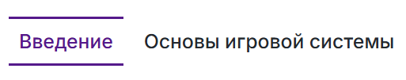
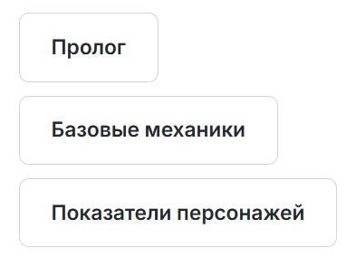
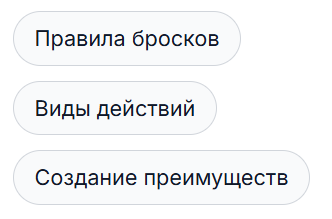
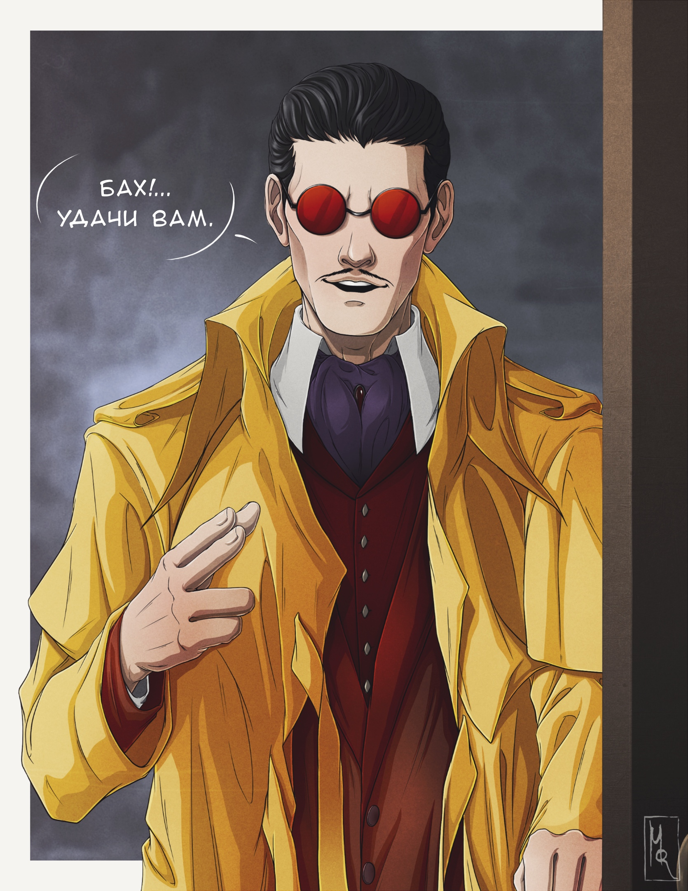

<link rel="stylesheet" href="style.css">

<nav class="navbar nav-demo nav-demo-5">
  <a href="start.html" aria-current="page">Введение</a>
  <a href="SistemaVT.html">Основы игровой системы</a>
  <a href="Homerules.html">Правила «Тишины»</a>
  <a href="Game-Master-Code-of-Conduct.html">Кодекс Мастеров</a>
  <a href="Project-Organization.html">Организация проекта</a>
</nav>

<link rel="stylesheet" href="style.css">

<h1 class="center">Введение</h1> 

Доброго времени суток и добро пожаловать в «Тишину»!

На этом сайте собраны практически все основные правила, общие договорённости и организационные принципы нашего проекта. Здесь вы найдёте правила игровой системы, описание и особенности работы «Тишины», правила для Мастеров и информацию об организации самого проекта.

Правил у нас довольно много. За годы существования проекта экосистема наших правил значительно разрослась, поэтому мы не ожидаем и не требуем, чтобы вы прочитали всё сразу.

Напротив - мы предлагаем знакомиться с правилами постепенно, в своём темпе и по мере необходимости.

---

<h2>С чего начать?</h2>  

Для вашей первой игры вам достаточно ознакомиться с главой **«Базовые механики»** в разделе «Основы игровой системы». Именно там описаны главные игровые принципы.

Этого будет достаточно, чтобы начать играть.

Мы предполагаем, что после первой партии вы постепенно познакомитесь и с остальными механиками. Правила построены по принципу последовательного погружения: сначала рассматриваются самые необходимые и базовые элементы системы, а затем постепенно открываются более сложные и специализированные механики.

Сначала освойте основные правила системы, а затем постепенно открывайте для себя более глубокие механики, описанные в Правилах «Тишины». Не пытайтесь прочитать все правила за один раз.

Начните с основ, сыграйте свою первую игру, исследуйте систему постепенно.

Мы не требуем от вас знания всего проекта целиком - они рассчитаны на то, что вы будете открывать проект поэтапно.

---

<h2> Как устроены наши правила?</h2>

Прежде чем приступить к изучению правил, давайте договоримся о нескольких терминах, чтобы легче ориентироваться.

<table class="simple-table image-text-table">

    <colgroup>
        <col style="width:60%;">
        <col style="width:40%;">
    </colgroup>

    <!-- Строка 1 -->
    <tr>
        <td class="text-cell">
                
Вся наша экосистема правил разделена на пять <strong>Разделов</strong>. Каждый из них объединяет материалы, посвящённые определённой стороне проекта: от игровой системы до организации работы «Тишины».   Найти Разделы можно в верхней части каждой страницы.

        </td>
        <td class="image-cell">
            
        </td>
    </tr>
    <!-- Строка 2 -->
    <tr>
        <td class="text-cell">
                
Каждый Раздел, в свою очередь, делится на <strong>Категории</strong>. Каждая Категория объединяет материалы, посвящённые отдельной большой теме внутри Раздела.   На сайте Категории отображаются в виде прямоугольных кнопок.

        </td>
        <td class="image-cell">
            
        </td>
    </tr>
    <!-- Строка 3 -->
    <tr>
        <td class="text-cell">
                
Категории часто делятся на <strong>Главы</strong> - отдельные материалы, посвящённые конкретным вопросам внутри общей темы.   На сайте Главы отображаются в виде небольших серых капсул.

        </td>
        <td class="image-cell">
            
        </td>
    </tr>

</table>

---

<h2>Читайте правила по необходимости</h2>

Базово для того чтобы играть в проекте, вам необходимо прочитать раздел **«Основы игровой системы»**, остальное - по желанию и по мере необходимости. 

  
<strong>Руководствуйтесь подобным принципом:</strong>
 
  
  •  Считаете, что достаточно разбираетесь в системе, чтобы создать свой Талант - прочтите главу "Создание Талантов"    •  Хотите разобраться с Крафтом и начать создавать собственные предметы - углубитесь в раздел "Создание предметов".    •  Интересует Даунтайм - когда будете готовы, переходите к главе «Инициативы, возможности и свободное время».    •  Если вы хотите стать Мастером, проводить собственные игры - обратитесь к разделу «Кодекс Мастеров».    •  Если вам хочется не только играть, но и помогать развивать сам проект, загляните в раздел «Организация проекта».

И так далее. Необязательно заранее изучать углубленную механику, которой вы пока не собираетесь пользоваться. 

---

<h2>Откуда взялась система правил «Тишины»? </h2> 

Наша игровая система берёт своё начало в оригинальной системе «Внутренних Теней».

Однако за годы существования проекта мы значительно переработали и дополнили её собственными механиками. Причина проста: исходная система создавалась для другого формата - игр одного Мастера, ведущего длительную кампанию для фиксированной группы игроков.

«Тишина», конечно, устроена иначе.

У нас Открытый Стол, множество партий, множество Мастеров и множество игроков, чьи персонажи постоянно переходят из одной истории в другую. Поэтому часть оригинальных механик пришлось изменить, дополнить или полностью переосмыслить, чтобы они соответствовали нашему формату.

При этом мы сохраняем уважение к основным принципам первоначальных правил и стараемся сохранить дух этой игровой системы.

Если однажды вам станет интересно познакомиться с оригинальными правилами, найти их можно <a href="https://bsamedy.github.io/inner-shadows-trpg-rules/">здесь</a>. 

---

<h2>Как записаться на игру?</h2>

Когда Мастер публикует объявление о предстоящей игре, вы можете выразить желание поучаствовать, поставив «+» в комментариях к публикации. Этого достаточно, чтобы Мастер понял, что вы хотели бы присоединиться к партии.

Не стесняйтесь записываться, даже если до вас уже отметилось много других игроков. У нас нет строгой очереди по принципу «кто первый записался, тот и попал на игру». Мастер самостоятельно формирует состав партии, учитывая её особенности и количество желающих.

Через некоторое время после публикации объявления Мастер сообщит, кого из записавшихся он берёт на свою партию. Поэтому не спешите отказываться от возможности поучаствовать, даже если под объявлением уже много отметок: пока Мастер не объявил окончательный состав, у вас есть все шансы попасть на игру.

<table class="simple-table center-all-table">

    <tr>
        <td class="center">
            
        </td>
    </tr>

</table>

**Важно**: в любом случае Мастер сообщит вам о своём решении - будете вы участвовать в игре или нет. Вы не останетесь в неизвестности и всегда будете проинформированы о том, удалось ли вам попасть в состав партии.

В нашем проекте никто не контролирует вашу запись на игры и не будет подталкивать вас к участию. Вы сами решаете, когда и на какие партии хотите записаться. Мы рассчитываем на вашу самостоятельность: не нужно ждать персонального приглашения от Мастера - если вы увидели интересное объявление, то поставьте «+».

Если вас не взяли на игру, не расстраивайтесь. Иногда количество желающих превышает возможности Мастера, и он просто не может вместить всех в одну партию. В таком случае смело записывайтесь на следующие игры - у вас обязательно появится возможность поучаствовать.

И самое важное: мы всегда рады новым игрокам! Собственно, именно поэтому вы сейчас читаете это руководство. Не бойтесь проявлять инициативу и пробовать себя в играх «Тишины».

---

<h2>Самые главные правила</h2> 

Прежде чем сделать свои первые шаги в мире Столицы и приступить к игре, вам необходимо прочесть главу **«Правила поведения в сообществе»**.

Среди всех правил нашего проекта именно они, пожалуй, самые важные. Ведь прежде чем мы начнём вместе играть, создавать истории и развивать проект, нам важно договориться о том, как мы будем относиться друг к другу.

  <a href="Community-Code-of-Conduct.html">Правила поведения в сообществе</a> 

После прочтения этих правил - смело переходите в первый раздел - <a href="https://theagencyofsilence.github.io/knowledge-archive/SistemaVT.html">«Основы игровой системы»</a> 

---

<strong><i>Добро пожаловать в «Тишину», друзья!</i></strong>
  

<strong><i>Надеемся, вам здесь понравится ♥</i></strong>
 

---

  

    
  

  

    
Агентство 
    «Тишина»

  

