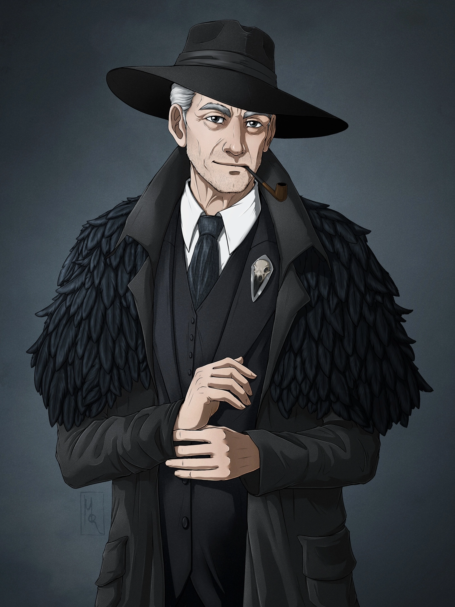

<link rel="stylesheet" href="style.css">

<nav class="navbar nav-demo nav-demo-5">
  <a href="start.html" aria-current="page">Введение</a>
  <a href="SistemaVT.html">Основы игровой системы</a>
  <a href="Homerules.html">Правила «Тишины»</a>
  <a href="Game-Master-Code-of-Conduct.html">Кодекс Мастеров</a>
  <a href="Project-Organization.html">Организация проекта</a>
</nav>

<h1 class="center">Тестовая страница</h1> 

<!-- 2. Прямоугольная кнопка -->

  <a class="navbtn-2" href="1-fortitude.html">Категория</a>

<!-- Вариант 5 -->
<nav class="navbar nav-demo nav-demo-5">
  <a href="#" aria-current="page">Главная</a>
  <a href="#">Правила</a>
  <a href="#">О проекте</a>
</nav>

<h2> Как устроены наши правила?</h2>

Прежде чем приступить к изучению правил, давайте договоримся о нескольких терминах, чтобы легче ориентироваться.

Наконец, внутри самих Глав вы встретите пункты - отдельные смысловые блоки, которые последовательно раскрывают тему. Они оформлены с помощью заголовков и собраны в оглавлении соответствующей страницы.

Здесь будет изображение с примером пунктов.

<table class="simple-table image-text-table">

    <colgroup>
        <col style="width:60%;">
        <col style="width:40%;">
    </colgroup>

    <!-- Строка 1 -->
    <tr>
        <td class="text-cell">
                
Вся наша экосистема правил разделена на пять Разделов. Каждый из них объединяет материалы, посвящённые определённой стороне проекта: от игровой системы до организации работы «Тишины». Найти их можно в верхней части каждой страницы.

        </td>
        <td class="image-cell">
            
        </td>
    </tr>
    <!-- Строка 2 -->
    <tr>
        <td class="text-cell">
                
Каждый Раздел, в свою очередь, делится на Категории. Каждая Категория объединяет материалы, посвящённые отдельной большой теме внутри Раздела. На сайте они отображаются в виде прямоугольных кнопок.

        </td>
        <td class="image-cell">
            
        </td>
    </tr>
    <!-- Строка 3 -->
    <tr>
        <td class="text-cell">
                
Категории часто делятся на Главы - отдельные материалы, посвящённые конкретным вопросам внутри общей темы. На сайте Главы отображаются в виде небольших капсул.

        </td>
        <td class="image-cell">
            
        </td>
    </tr>
    <!-- Строка 4 -->
    <tr>
        <td class="text-cell">
                
Наконец, внутри самих Глав вы встретите пункты - отдельные смысловые блоки, которые последовательно раскрывают тему. Они оформлены с помощью заголовков и собраны в оглавлении соответствующей страницы.

        </td>
        <td class="image-cell">
            
        </td>
    </tr>

</table>

---

  

    
  

  

    
Агентство 
    «Тишина»

  

